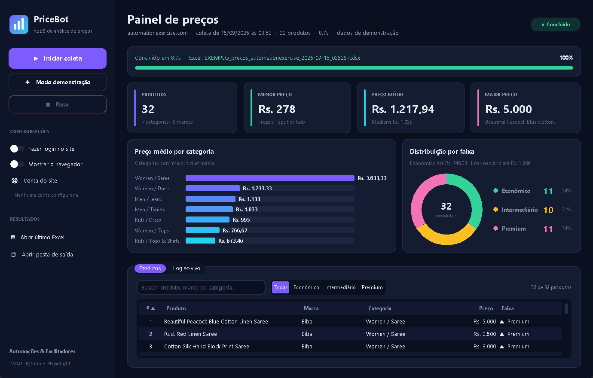
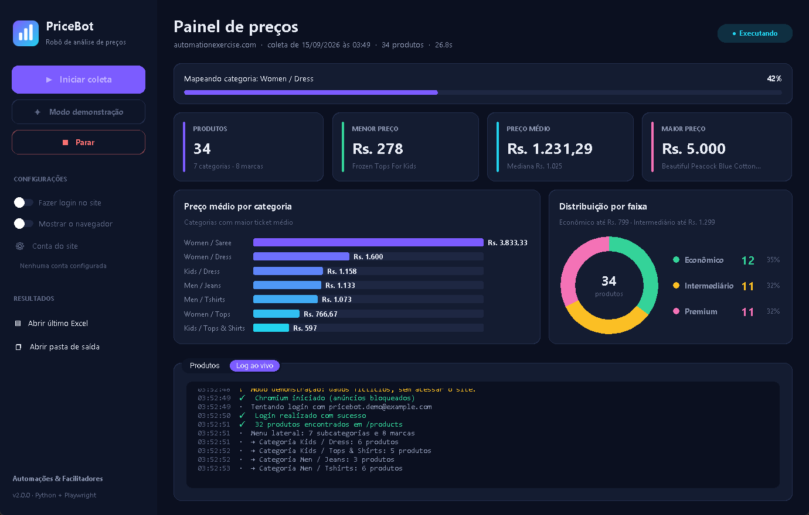
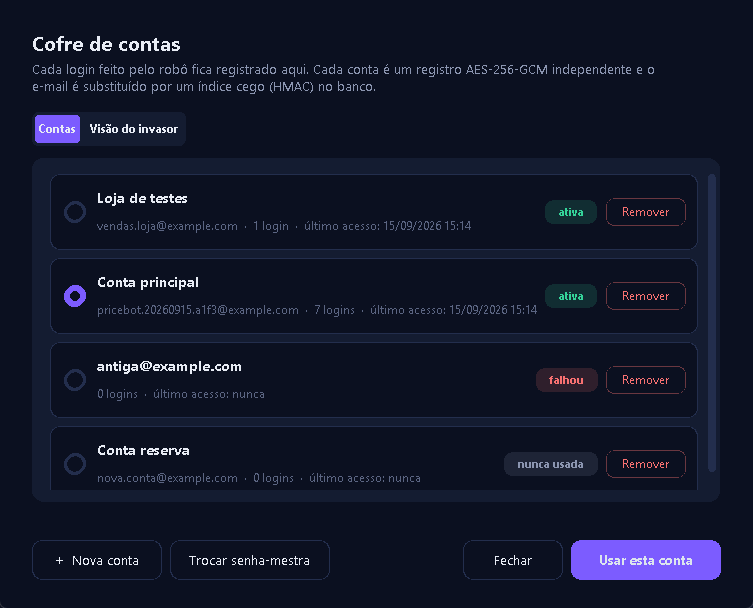
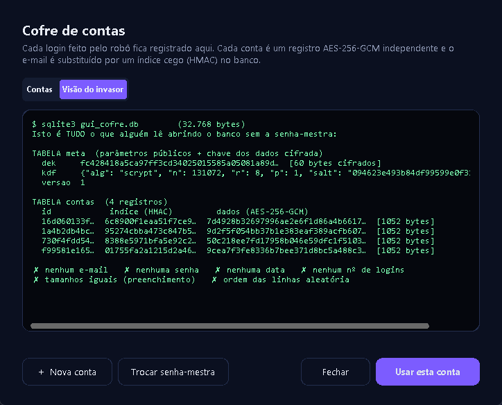

<div align="center">


# PriceBot

**Robô de análise de preços com interface moderna e cofre de contas criptografado**


</div>

O PriceBot entra num e-commerce, faz login, coleta **todos os produtos e preços**, identifica **categoria e marca**, classifica tudo em **faixas de preço** e entrega um **Excel pronto com resumo e gráficos**.

O trabalho que levaria horas de copiar e colar termina em **menos de 30 segundos**, com um clique.

<div align="center">

</div>

---

## ✨ Destaques

| | |
|---|---|
| 🖱️ **Um clique** | `Iniciar.bat` cria o ambiente, instala tudo e abre o app. Não precisa saber programar |
| 📊 **Painel ao vivo** | Indicadores animados, gráficos, tabela com busca e filtros, log em tempo real |
| 🔐 **Cofre criptografado** | Toda conta usada no login fica guardada com AES-256-GCM + scrypt |
| 📑 **Excel profissional** | Aba de resumo com gráficos e fórmulas; aba de itens com faixa e ranking |
| ⚡ **Rápido** | Leitura otimizada das páginas e bloqueio de anúncios |
| 🛑 **Seguro de parar** | Botão *Parar* interrompe com segurança e fecha o navegador |
| 🎬 **Modo demonstração** | Simula uma coleta completa, sem internet, para apresentações |

<div align="center">

</div>

---

## 🔐 Cofre de contas: nem quem abre o banco descobre nada

Todas as contas que o robô usa ficam guardadas **com o histórico de acessos** num banco SQLite. Quem copiar o arquivo e abrir sem a senha-mestra **não vê e-mail, senha, data nem quantidade de logins**.

<div align="center">


</div>

```
senha-mestra ──scrypt (N=2^17, r=8)──▶ KEK
KEK ──AES-256-GCM──▶ DEK (chave aleatória de 256 bits, gravada cifrada)
DEK ──HKDF──┬──▶ chave de dados  → cada conta vira um registro AES-256-GCM
            └──▶ chave de índice → o e-mail vira um HMAC ("índice cego")
```

| Sem a senha-mestra, ninguém vê… | Porque |
|---|---|
| ❌ e-mails | a coluna guarda só um HMAC com chave secreta |
| ❌ senhas, datas e nº de logins | ficam dentro do registro cifrado |
| ❌ quem tem mais acessos | todo registro tem o mesmo tamanho (preenchimento de 4 KB) |
| ❌ ordem de cadastro | ids aleatórios em tabelas `WITHOUT ROWID` |
| ❌ contas apagadas | `PRAGMA secure_delete` sobrescreve os dados |
| ❌ como adulterar sem ser pego | o GCM autentica cada registro e o amarra à própria linha |

> Limites, sendo transparente: a **quantidade** de registros é visível; enquanto o cofre está desbloqueado as chaves ficam na memória; e sem a senha-mestra não há recuperação.

---

## 📑 Relatório gerado

[⬇️ Baixe um relatório de exemplo](docs/exemplo_relatorio.xlsx)

- **Resumo**: total, menor, médio, mediana e maior preço, contagem por faixa, tabela por categoria e 2 gráficos.
- **Itens**: um produto por linha, com marca, categoria, **faixa e ranking calculados por fórmula**. Mude um limite de faixa e a planilha inteira se reclassifica.

---

## 🚀 Como usar

1. Instale o [Python 3.10+](https://www.python.org/downloads/) (marque **"Add python.exe to PATH"**).
2. Baixe este repositório e dê **dois cliques em `Iniciar.bat`**.
   - Na primeira vez, ele cria a `.venv`, instala as dependências e o Chromium automaticamente.
3. Clique em **▶ Iniciar coleta** ou em **✦ Modo demonstração**.

Opcional: `Criar atalho na Area de Trabalho.bat` cria um ícone do PriceBot no desktop.

<details>
<summary><b>Linha de comando</b></summary>

```bash
.venv\Scripts\activate
python gerenciar_contas.py adicionar   # cria o cofre e adiciona uma conta
python gerenciar_contas.py listar
python gerenciar_contas.py invasor     # o que alguém vê no banco sem a senha
python main.py                         # coleta com a conta usada mais recentemente
python main.py --conta email@x.com     # escolhe a conta
python main.py --sem-login | --demo | --mostrar-navegador
```
</details>

<details>
<summary><b>Estrutura do projeto</b></summary>

```
Iniciar.bat                      ← abre o app (cria a venv se precisar)
app.py                           ← interface gráfica
main.py                          ← versão linha de comando
gerenciar_contas.py              ← cofre de contas pelo terminal
gerar_demo.py                    ← gera um Excel de exemplo
robo_precos/
  cofre.py                       ← cofre criptografado (scrypt + AES-GCM + HMAC)
  pipeline.py                    ← orquestra a execução e registra os acessos
  auth_bot.py                    ← login / cadastro automático
  price_scraper.py               ← coleta de produtos, categorias e marcas
  analise.py                     ← estatísticas e faixas de preço
  classify_export.py             ← Excel com resumo e gráficos
  gui/                           ← janela, componentes, diálogos, tema e ícone
```
</details>

---

## 🛠️ Tecnologias

**Python** · **Playwright** (automação do navegador) · **CustomTkinter** (interface) · **openpyxl** (Excel) · **cryptography** (AES-GCM, scrypt, HKDF) · **SQLite**

---

## 💼 Precisa de uma automação assim para o seu negócio?

Este projeto é uma **vitrine** do que eu desenvolvo. Posso criar uma solução sob medida para você:

- 🛒 **Monitoramento de preços** de concorrentes e fornecedores
- 🔁 **Automação de rotinas em sites**: login, formulários, downloads, cadastros
- 📊 **Relatórios automáticos** em Excel, e-mail ou painel web
- 🖥️ Entrega como **programa instalável** ou **rodando em servidor** com agendamento diário
- 🔐 Com **segurança de verdade** para senhas e dados dos seus clientes

**Entre em contato:** [github.com/PitsayCode](https://github.com/PitsayCode)

---

<sub>ℹ️ Nesta demonstração o robô usa o [automationexercise.com](https://automationexercise.com), um site público criado para treino de automação. Os preços são fictícios, em rúpias (`Rs.`). Em projetos reais, a coleta respeita os termos de uso do site-alvo e a LGPD.</sub>

<sub>© 2026 PitsayCode. Todos os direitos reservados. Veja [LICENSE](LICENSE).</sub>
